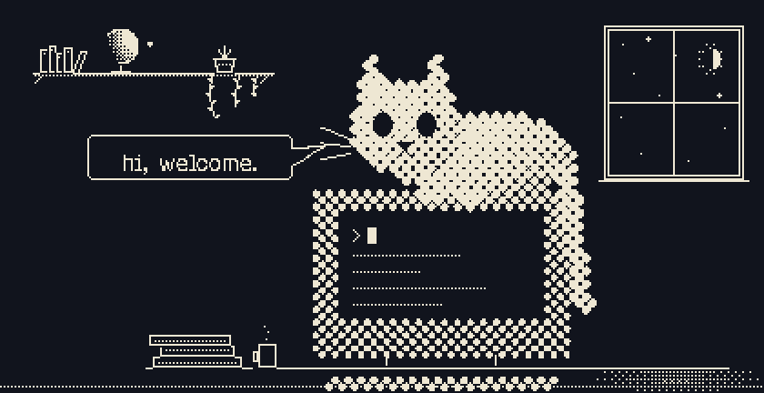

<picture></picture>

Curiosity killed the cat, but satisfaction brought it back. 

<picture></picture>

 

<picture></picture>
<picture></picture>
<picture></picture>
<!-- Replace the # in the next three links when the URLs are ready -->

